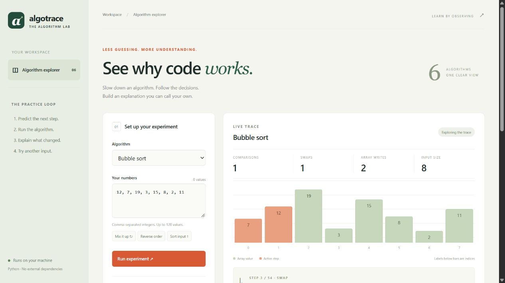

# AlgoTrace

**See why code works.** A local Python algorithm lab for tracing, comparing and explaining search and sorting algorithms.



## What you can do

- Step through linear search, binary search, bubble sort, insertion sort, selection sort and merge sort.
- Inspect array snapshots, active indices, search intervals, pseudocode and operation counters.
- Play, pause, scrub or reverse through a recorded trace.
- Compare four sorts on exactly the same input.
- Try duplicates, negative values, empty input and reverse-sorted arrays.
- Export a run as JSON. Write a learning note, save it in browser storage or download it as Markdown.
- Run algorithms through the command line without using the browser.

## Run on Windows

Requires **Python 3.10 or newer**. There are no third-party packages, API keys or accounts to configure.

1. Extract the project folder if using the ZIP.
2. Open a terminal in the project folder, or double-click `Start-AlgoTrace.bat`.
3. Run:

```powershell
python -m algotrace serve
```

4. Open **http://127.0.0.1:8765** in a browser. Keep the terminal running.
5. Stop the server with **Ctrl+C**.

If Windows uses the Python launcher, replace `python` with `py -3`. If the port is busy:

```powershell
python -m algotrace serve --port 8766
```

The server accepts its printed `127.0.0.1` address, rather than `localhost` aliases. It binds only to loopback and is intended for a single learner on their own computer. It is not a production hosting server.

## First experiment

1. Choose Bubble sort and enter `3, 2, 1`.
2. Predict the first swap, then click **Run experiment**.
3. Step forward. The completed result should show **3 comparisons, 3 swaps and 6 main-array writes**.
4. Choose **Sort input**, run again and compare the counts.
5. Click **Compare all sorts**. Explain why fewer comparisons alone do not prove an algorithm is fastest.

For binary search, sort the input explicitly before running. Sorting cost is not included in search counters. With duplicate keys, binary search returns one matching index, while linear search returns the first.

## Counting rules and limits

- A comparison is one conceptual three-way comparison of two keys, even when Python uses more than one operator to determine the relationship. Loop checks, sorted-input validation and bookkeeping are not included.
- A swap increments the swap count by one and main-array writes by two. Insertion and merge use writes instead of swaps.
- Merge sort's auxiliary copies and Python list overhead are not included in main-array writes.
- Complexity describes the algorithm, excluding trace snapshots and UI/server overhead. Merge sort uses O(n) auxiliary space; the other included algorithms use O(1) auxiliary algorithm space.
- Input is limited to 128 integers between -1,000,000 and 1,000,000.
- A web run retains the first 500 events and always retains the completion event. When capped, a visible warning explains the jump. Algorithms still finish, and all counters include the omitted events.
- Bar heights are normalized to the current minimum and maximum; values are printed explicitly. This is an array illustration, not a zero-baseline quantitative chart.
- Comparison tables highlight the fewest key comparisons for that specific input. They are not a timing benchmark or universal ranking.
- Notes live in this browser's storage. They are not synced or sent to a service. Clearing browser data removes them; download a copy if needed.

## Command line

```powershell
python -m algotrace run binary --values "1,3,5,7,9" --target 7
python -m algotrace run merge --values "12,7,19,3,15,8,2,11"
python -m algotrace run bubble --values "3,2,1" --compare
```

## Tests

```powershell
python -m unittest discover -s tests -v
```

Tests cover seeded comparisons with Python's sorted output, searches against reference answers, exact operation counts, input immutability, trace caps, validation, real HTTP endpoints, static file boundaries and CLI behavior. Browser verification is recorded separately in `docs/VERIFICATION.md`.

## Project map

```text
algotrace/
  algorithms.py     # Pure algorithm implementations and trace recorder
  server.py         # Small loopback-only HTTP and JSON interface
  __main__.py       # Command-line entry point
  web/
    index.html      # Browser lab
    style.css       # Responsive layout
    app.js          # Playback, input, comparison and notes
tests/              # Standard-library unittest suite
docs/               # Screenshot, learning guide and verification
```

## API

- `GET /api/catalog`: algorithm metadata and pseudocode.
- `POST /api/run`: JSON `{ "algorithm": "bubble", "values": [3,2,1] }`. Include `target` for searches.
- `POST /api/compare`: JSON `{ "values": [3,2,1] }`, returns four sort summaries.

Requests must come through the printed address. The app rejects mismatched Host/Origin headers, non-JSON POST bodies and oversized requests. These are narrow local-app protections, not a claim of a complete security audit.

## Authorship and learning

This initial implementation was built with AI assistance. It is a learning/reference project, not evidence that the owner independently wrote or mastered every part. Read `docs/LEARNING.md`, explain the existing code, and make your own documented changes before presenting it as an independent accomplishment. No solved-problem history, user metrics or test outcomes are fabricated.

## License

MIT. See `LICENSE`.
